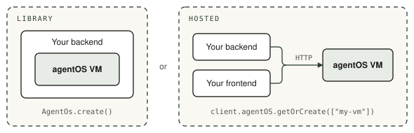
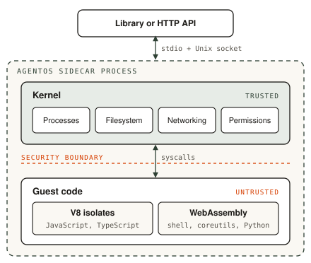

<div align="center">
  <br/>
  <a href="https://rivet.dev/agentos">
    <picture>
      <source media="(prefers-color-scheme: dark)" srcset="./.github/media/logo/agentos-white.svg">
      
    </picture>
  </a>
  <br/>
  <br/>
  <h3>Tiny, fast, Linux-compatible sandboxes. Powered by WebAssembly.</h3>
  <p>
    92× faster cold starts, 47× less memory, 254× cheaper to run.<br/>
    Each agent gets files, processes, shell, and networking in one lightweight OS.
  </p>
  <p>
    <a href="#quickstart">Quickstart</a> •
    <a href="https://rivet.dev/agentos/docs">Documentation</a> •
    <a href="https://www.rivet.dev/changelog">Changelog</a> •
    <a href="https://www.rivet.dev/discord">Discord</a> •
    <a href="https://x.com/rivet_dev">X</a>
  </p>
</div>

## Why agentOS

Powered by WebAssembly and V8 isolates, the same technology powering Chrome and
Cloudflare Workers. Linux with POSIX files, processes, and networking.

- **Library, not extra infrastructure.** Install agentOS from npm and run it inside the backend process you already operate.
- **WebAssembly + V8, not a microVM.** V8 isolates run JavaScript while WebAssembly contains compiled tools inside the same compact runtime.
- **Direct function calls, not extra APIs.** Connect agents to your application with ordinary JavaScript calls instead of another network service.
- **Scoped access, not exposed credentials.** Bind trusted host functions without ever giving the agent your raw secrets.
- **One process, not a VM per agent.** Many isolated agent operating systems share one compact runtime instead of duplicating a full microVM stack.
- **Runs anywhere, no nested virtualization.** Deploy on standard Linux infrastructure without a hypervisor or nested virtualization.

## Benchmarks

| Metric | agentOS | Sandbox baseline | Difference |
|---|---|---|---|
| Cold start, p50 | 4.8 ms | 440 ms | 92× faster |
| Cold start, p95 | 5.6 ms | 950 ms | 170× faster |
| Cold start, p99 | 6.1 ms | 3,150 ms | 516× faster |
| Memory, shell workload | ~22 MB | 1,024 MB | 47× less |
| Cost per execution-second, shell workload | $0.000000073 | $0.000018 | 254× cheaper |

See the [benchmark details](https://rivet.dev/agentos#bench-cold-start) for
methodology, or [Performance](https://rivet.dev/agentos/docs/performance) to run
the benchmarks yourself.

## Quickstart

<p align="center">
  <picture>
    <source media="(prefers-color-scheme: dark)" srcset="./.github/media/library-vs-hosted-dark.svg">
    
  </picture>
</p>

<div align="center">

|  | Library | Hosted |
|---|---|---|
| **Runs** | Inside your process | Durable instance on Rivet Cloud or self-hosted |
| **Lifecycle** | Runs until `dispose()` or process exit | Sleeps when idle unless a process is running |
| **Clients** | Your backend | Your backend, or browsers with a scoped JWT |
| **Preview URLs** | None | Expiring preview URLs |

</div>

### Library

**Step 1: Install the library**

```bash
npm install @rivet-dev/agentos-core
```

**Step 2: Create a VM and use it**

```ts
import { AgentOs } from "@rivet-dev/agentos-core";

// Boots a VM inside this process. It runs until dispose() or process exit.
const vm = await AgentOs.create();

try {
	// Bash
	const result = await vm.process.exec("echo hello && ls /home/agentos", {
		output: { capture: "all" },
	});
	console.log(result.stdout);

	// Filesystem
	await vm.filesystem.writeFile("/home/agentos/hello.txt", "Hello, world!");
	const file = await vm.filesystem.readFile("/home/agentos/hello.txt");

	// JavaScript
	await vm.javascript.execute("console.log(1 + 2)");

	// Python
	const answer = await vm.python.evaluate<number>("21 * 2");
} finally {
	await vm.dispose();
}
```

**Step 3: Configure the VM**

The filesystem is in memory by default. Pass options to `AgentOs.create()` to
persist it, attach other filesystems, and lock the VM down.

```ts
import { resolve } from "node:path";
import { AgentOs } from "@rivet-dev/agentos-core";

const vm = await AgentOs.create({
	// Store the root filesystem in SQLite so files survive VM recreation.
	database: { type: "sqlite_file", path: resolve("agentos.sqlite") },
	rootFilesystem: { type: "native", plugin: { id: "chunked_sqlite", config: {} } },

	// Attach a host directory (read-only) and an S3 bucket.
	mounts: [
		{
			path: "/mnt/code",
			plugin: { id: "host_dir", config: { hostPath: "/path/to/repo" } },
			readOnly: true,
		},
		{
			path: "/mnt/data",
			plugin: { id: "chunked_s3", config: { bucket: "my-bucket", region: "us-east-1" } },
		},
	],

	// Environment variables for guest processes.
	environment: { NODE_ENV: "production" },

	// Deny network access except to one host.
	permissions: {
		network: {
			default: "deny",
			rules: [
				{
					mode: "allow",
					operations: ["*"],
					patterns: ["dns://api.example.com", "tcp://api.example.com:*"],
				},
			],
		},
	},

	// Cap processes and filesystem size.
	limits: { resources: { maxProcesses: 64, maxFilesystemBytes: 256 * 1024 * 1024 } },
});
```

See [Filesystem](https://rivet.dev/agentos/docs/filesystem),
[Persistence](https://rivet.dev/agentos/docs/persistence),
[Permissions](https://rivet.dev/agentos/docs/permissions),
[Resource Limits](https://rivet.dev/agentos/docs/resource-limits), and
[Host Functions](https://rivet.dev/agentos/docs/host-functions).

### Hosted

**Step 1: Create a project**

Create a project in the [Rivet dashboard](https://dashboard.rivet.dev) and
choose agentOS as the product. Set `RIVET_NAMESPACE` and `RIVET_TOKEN` from
the project. To run on your own infrastructure, see
[Self-Hosting](https://rivet.dev/agentos/docs/self-hosting).

**Step 2: Install the client**

```bash
npm install @rivet-dev/agentos
```

**Step 3: Create a VM and use it**

```ts
import { createAgentOsClient } from "@rivet-dev/agentos";

const client = createAgentOsClient({ endpoint: "https://api.rivet.dev" });

// Creates the VM on first use and returns the same VM for the same key.
const vm = client.agentOS.getOrCreate(["my-vm"]);

const result = await vm.v1.process.run({
	command: "sh",
	args: ["-c", "echo hello && ls /home/agentos"],
	options: { captureStdio: true },
});
console.log(result.stdout);

await vm.v1.filesystem.writeFile({
	path: "/home/agentos/hello.txt",
	content: "Hello, world!",
});

// Start a server and expose it through an expiring preview URL.
await vm.v1.filesystem.writeFile({
	path: "/home/agentos/server.js",
	content: `require("node:http").createServer((req, res) => res.end("hello")).listen(3000);`,
});
await vm.v1.process.spawn({ command: "node", args: ["/home/agentos/server.js"] });
const preview = await vm.v1.network.preview.create({ port: 3000, ttlMs: 60 * 60 * 1_000 });
```

The client is optional. Every action is a plain HTTP call. Create the VM by
key with your `RIVET_TOKEN`, then call `POST /gateway/{vm_id}/action/v1.{group}.{action}`
with a token that can reach the VM.

<details>
<summary>Raw HTTP with curl</summary>

```bash
curl -X PUT "https://api.rivet.dev/actors?namespace=$RIVET_NAMESPACE" \
  -H "Authorization: Bearer $RIVET_TOKEN" \
  --json '{
    "name": "agentOS",
    "key": "my-vm",
    "runner_name_selector": "services",
    "crash_policy": "sleep"
  }'
# → { "actor": { "actor_id": "…" }, "created": true }

curl "https://api.rivet.dev/gateway/$VM_ID/action/v1.process.run" \
  -H "x-rivet-token: $VM_TOKEN" \
  --json '{"args": [{
    "command": "sh",
    "args": ["-c", "echo hello"],
    "options": { "captureStdio": true }
  }]}'
# → { "output": { "status": { "exitCode": 0, … }, "stdout": "hello\n", "stderr": "" } }
```

</details>

Keep `RIVET_TOKEN` on your backend. To let a browser call one VM directly,
issue it a JWT scoped to that VM.

**Step 4: Configure the VM**

Configuration is stored with the VM and versioned. Replace it with
`v1.config.set`, then restart the VM so filesystem and software changes take
effect.

```ts
const vm = client.agentOS.getOrCreate(["my-vm"]);

await vm.v1.config.set({
	config: {
		// Keep files across sleep and restarts, and mount durable storage at /data.
		filesystem: {
			root: { type: "durable" },
			mounts: [{ path: "/data", backend: { type: "durable" } }],
		},

		// Environment variables for guest processes.
		environment: { NODE_ENV: "production" },

		// Deny network access except to one host.
		permissions: {
			network: {
				default: "deny",
				rules: [
					{
						mode: "allow",
						operations: ["*"],
						patterns: ["dns://api.example.com", "tcp://api.example.com:*"],
					},
				],
			},
		},
	},
});

// Filesystem and software changes apply after a restart.
await vm.v1.vm.restart({});
```

See [Persistence](https://rivet.dev/agentos/docs/persistence),
[Permissions](https://rivet.dev/agentos/docs/permissions), and the
[Hosted HTTP API](https://rivet.dev/agentos/docs/hosted-api) for every config
field.

## Architecture

<p align="center">
  <picture>
    <source media="(prefers-color-scheme: dark)" srcset="./.github/media/architecture-dark.svg">
    
  </picture>
</p>

The agentOS sidecar is a Rust process that runs separately from your
application's process. The kernel and all guest code live in the sidecar, so
untrusted code and its memory never enter your process. The library,
`@rivet-dev/agentos-core`, starts and owns the sidecar from your backend and
talks to it over stdio and a Unix socket. When hosted, you control the same
sidecar over the HTTP API.

The sidecar's trusted kernel owns the process table, the virtual filesystem and
its mounts, the socket table, and permissions and resource limits.

Untrusted guest code also runs inside the sidecar. JavaScript and TypeScript run
in V8 isolates, and the shell, coreutils, and Python run as WebAssembly.

The entire kernel is virtualized. Every file, process, and network operation is
a syscall into the kernel, so by default guest code can't reach host files,
processes, environment variables, or the network. You opt in to host access
with mounts, host functions, and network permissions. See
[Architecture](https://rivet.dev/agentos/docs/architecture) for details.

## API Overview

Library methods live under `vm.<group>`. Hosted actions live under
`vm.v1.<group>`, or `POST /gateway/{vm_id}/action/v1.<group>.<action>` over
HTTP. The table lists every method across both.

| Group | What it does | Methods |
|---|---|---|
| `vm` | Create, inspect, and stop VMs | `create`, `status`, `restart`, `dispose` |
| `config` | Stored, versioned VM configuration | `get`, `set`, `patch` |
| `process` | Run commands and manage child processes | `exec`, `execFile`, `run`, `spawn`, `get`, `list`, `tree`, `wait`, `signal`, `kill`, `writeStdin`, `closeStdin`, `resizePty`, `readOutput` |
| `terminal` | Interactive PTY sessions | `open`, `list`, `write`, `resize`, `readOutput`, `wait`, `close` |
| `filesystem` | Read, write, and list files; manage mounts | `readFile`, `writeFile`, `readFiles`, `writeFiles`, `stat`, `exists`, `mkdir`, `readdir`, `readdirEntries`, `readdirRecursive`, `move`, `remove`, `mount`, `unmount`, `listMounts`, `export` |
| `javascript` | Run Node.js code and npm | `execute`, `evaluate`, `executeFile`, `spawn`, `spawnFile`, `npm.install`, `npm.runScript`, `npm.runPackage` |
| `typescript` | Run and type-check TypeScript | `execute`, `evaluate`, `executeFile`, `spawn`, `spawnFile`, `check`, `checkProject` |
| `python` | Run Python code and pip | `execute`, `evaluate`, `executeFile`, `executeModule`, `spawn`, `spawnFile`, `spawnModule`, `install` |
| `contexts` | Persistent language execution contexts | `create`, `get`, `list`, `reset`, `delete` |
| `network` | Reach servers running in the VM | `httpRequest`, `fetch`, `fetchStream`, `preview.create`, `preview.expire` |
| `software` | Install `.aospkg` command packages | `install`, `uninstall`, `list`, `installed`, `link` |
| `cron` | Scheduled commands | `schedule`, `list`, `cancel` |

## License

See [LICENSE](LICENSE).
